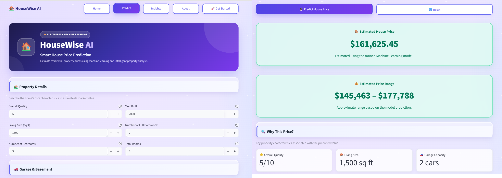
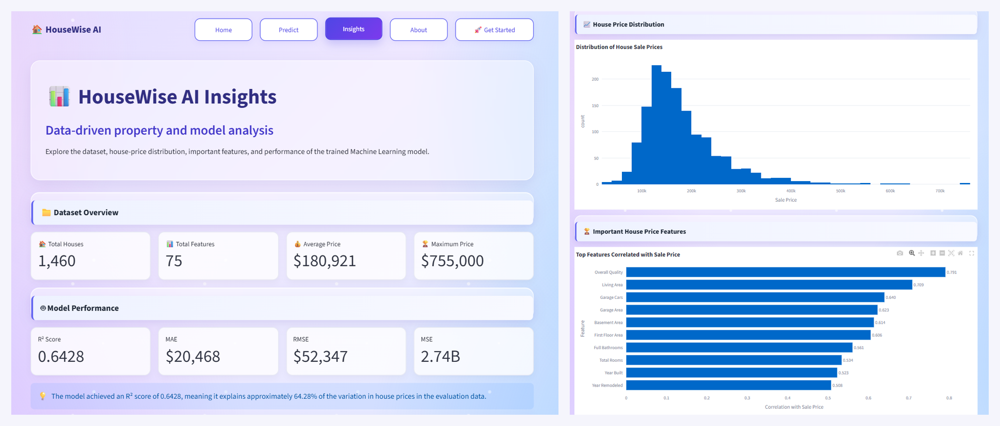
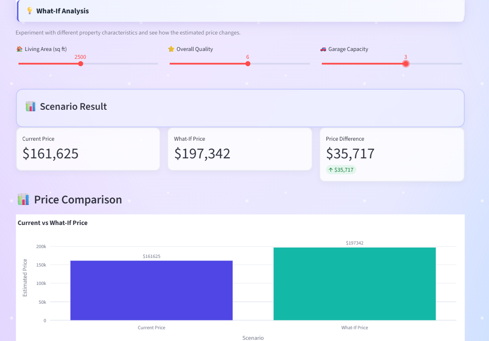
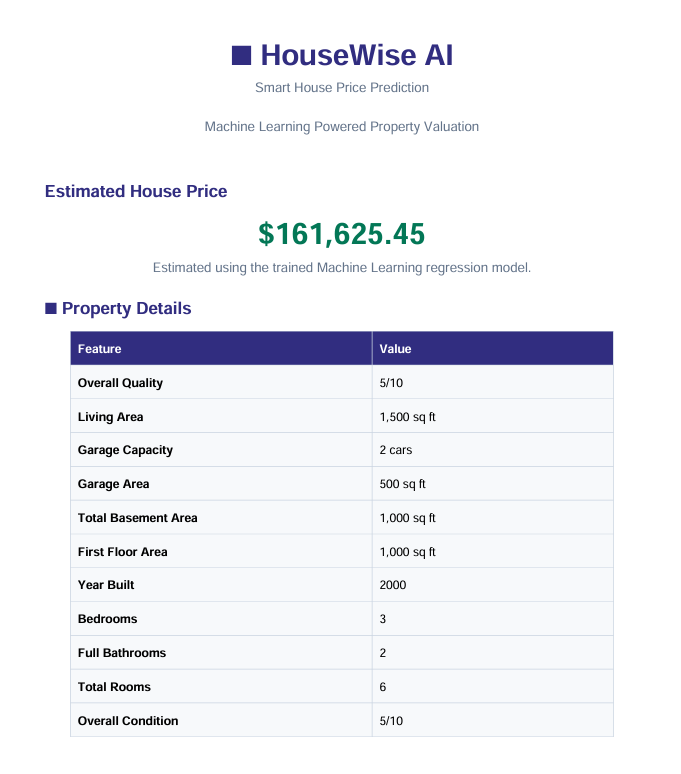

# 🏠 HouseWise AI

### Smart House Price Prediction using Machine Learning

HouseWise AI is a Machine Learning web application that predicts residential house prices based on important property characteristics.

The project combines a trained regression model with an interactive Streamlit interface to provide instant price predictions, property insights, what-if analysis, prediction history, and downloadable PDF reports.

---

## 🌐 Live Demo

🚀 **Try HouseWise AI:** [Launch Application](https://housewise-ai-sindhu.streamlit.app/)

[](https://housewise-ai-sindhu.streamlit.app/)

---

## 🚀 Features

- 🏠 House price prediction
- 📊 Property insights and summary
- 💡 What-if price analysis
- 📈 House price distribution visualization
- 🏆 Important feature analysis
- 🤖 Model performance metrics
- 📜 Prediction history
- 📥 Downloadable prediction history
- 📄 PDF prediction report generation
- 🔄 Reset prediction inputs
- 🎨 Interactive Streamlit interface
- 📱 Responsive user interface

---

## 🧠 Machine Learning

The application uses a trained regression model to estimate house sale prices.

### Model Evaluation

| Metric | Result |
|---|---:|
| R² Score | 0.6428 |
| MAE | $20,468 |
| RMSE | $52,347 |
| MSE | 2.74B |

The R² score indicates that the model explains approximately 64.28% of the variation in house prices on the evaluation dataset.

---

## 📊 Dataset

The project uses the **House Prices – Advanced Regression Techniques** dataset.

The dataset contains residential property characteristics such as:

- Overall quality
- Living area
- Garage capacity
- Garage area
- Basement area
- First floor area
- Year built
- Bedrooms
- Bathrooms
- Total rooms
- Overall condition

---

## 🔧 Data Preprocessing

The project includes:

- Handling missing values
- Removing columns with excessive missing data
- Median imputation for numerical features
- Mode imputation for categorical features
- One-hot encoding of categorical variables
- Feature alignment with the trained model

---

## 🛠️ Technologies Used

- Python
- Pandas
- NumPy
- Scikit-learn
- Plotly
- Streamlit
- Joblib
- ReportLab
- Jupyter Notebook

---

## 📂 Project Structure

```text
HousePricePrediction/
│
├── screenshots/
│   ├── home.png
│   ├── prediction.png
│   ├── insights.png
│   ├── report.png
│   └── what-if.png
│
├── app.py
├── data.csv
├── feature_importance.csv
├── house_price_model.pkl
├── HousePricePrediction_Final.ipynb
├── HouseWise_AI_Prediction_Report.pdf
├── requirements.txt
└── README.md
```

---

## 📸 Screenshots

### House Price Prediction


### Insights


### What-if Analysis


### Prediction Report PDF


---

## 👩‍💻 Author

Developed by **Sindhu S**